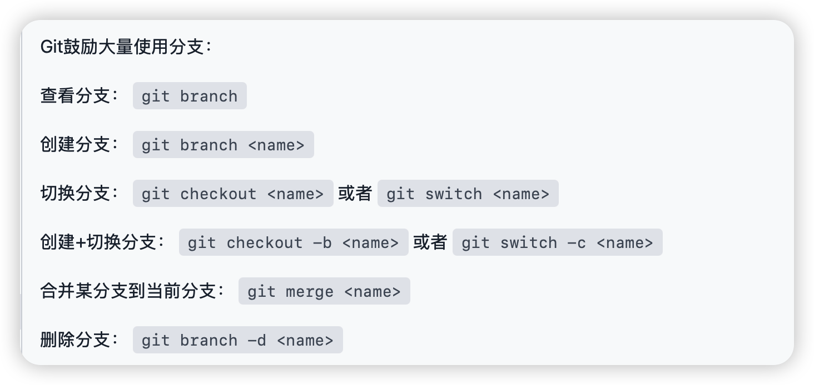

## A1
- add:把工作区修改的文件提交到暂存区 命令：git add <文件名>
- commit:提交暂存区的文件到本地仓库 命令：git commit -m "提交信息"
- push:把本地仓库的文件推到远程仓库 命令：git push <远程仓库地址> <分支名>
- pull:从远程仓库拉取文件到本地仓库 命令：git pull <远程仓库地址> <分支名>
- merge:合并两个分支 命令：git merge <分支名>
